

<picture><source media="(prefers-color-scheme: dark)" srcset="assets/hero-dark.svg"></picture>

<picture><source media="(prefers-color-scheme: dark)" srcset="assets/social-l-dark.svg"></picture><a href="https://www.linkedin.com/in/deepesh-dangi-377a1028a/"><picture><source media="(prefers-color-scheme: dark)" srcset="assets/social-1-dark.svg"></picture></a><a href="https://github.com/Deepesh70"><picture><source media="(prefers-color-scheme: dark)" srcset="assets/social-2-dark.svg"></picture></a><a href="https://stackoverflow.com/users/31307423/deepesh"><picture><source media="(prefers-color-scheme: dark)" srcset="assets/social-3-dark.svg"></picture></a><picture><source media="(prefers-color-scheme: dark)" srcset="assets/social-r-dark.svg"></picture>

<picture><source media="(prefers-color-scheme: dark)" srcset="assets/about-dark.svg"></picture>

<a href="https://www.scholardive.com/"><picture><source media="(prefers-color-scheme: dark)" srcset="assets/button-1-dark.svg"></picture></a>&nbsp;&nbsp;<a href="https://github.com/Deepesh70?tab=repositories"><picture><source media="(prefers-color-scheme: dark)" srcset="assets/button-2-dark.svg"></picture></a>&nbsp;&nbsp;<a href="https://buymeacoffee.com/deepesh70"><picture><source media="(prefers-color-scheme: dark)" srcset="assets/button-3-dark.svg"></picture></a>

<picture><source media="(prefers-color-scheme: dark)" srcset="assets/stats-dark.svg"></picture>

<a href="https://github.com/Deepesh70/Unreal-MCP"><picture><source media="(prefers-color-scheme: dark)" srcset="assets/project-unreal-mcp-dark.svg"></picture></a>&nbsp;<a href="https://github.com/Deepesh70/ai-anime-challenge"><picture><source media="(prefers-color-scheme: dark)" srcset="assets/project-ai-anime-challenge-dark.svg"></picture></a>

<a href="https://github.com/localai-org/kimodo.cpp"><picture><source media="(prefers-color-scheme: dark)" srcset="assets/project-kimodo-cpp-dark.svg"></picture></a>&nbsp;<a href="https://github.com/Jeevant010/Mini_Generative_Pretrained_Transformer"><picture><source media="(prefers-color-scheme: dark)" srcset="assets/project-mini-generative-pretrained-transformer-dark.svg"></picture></a>

<a href="https://github.com/Jeevant010/Shoot_Catcher"><picture><source media="(prefers-color-scheme: dark)" srcset="assets/project-shoot-catcher-dark.svg"></picture></a>&nbsp;<a href="https://github.com/Deepesh70/Flex-Watch"><picture><source media="(prefers-color-scheme: dark)" srcset="assets/project-flex-watch-dark.svg"></picture></a>

<picture><source media="(prefers-color-scheme: dark)" srcset="assets/streak-dark.svg"></picture>

<picture><source media="(prefers-color-scheme: dark)" srcset="assets/stack-dark.svg"></picture>

<a href="https://metawka.github.io/expressive-profile/?from=Deepesh70"><picture><source media="(prefers-color-scheme: dark)" srcset="assets/credit-dark.svg"></picture></a>

