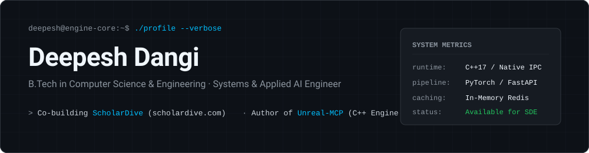

<!-- Custom Soft-Animated SVG Header -->

 

<!-- Soft Typing Animation for Core Focus Areas -->

 

<!-- Navigation & Contact Badges -->

 

## `01` // Engineering Focus & Architecture Philosophy

I am a Computer Science undergraduate (**B.Tech CSE**) building at the intersection of **native C++ runtime systems**, **from-scratch machine learning pipelines**, and **high-concurrency web backends**.

* **Systems & Engine Tooling:** Designing native C++ editor subsystems, procedural geometry generators, and JSON-RPC/WebSocket bridges that allow external LLM agents to manipulate 3D engine state with minimal frame-time overhead.
* **Applied AI & NLP Pipelines:** Moving beyond raw API wrappers by implementing custom Transformer architectures from mathematical first principles and engineering structured, schema-validated evaluation pipelines in production.
* **Backend & Caching Mechanics:** Building asynchronous ingestion services in FastAPI and Express, backed by strict schema validation, MongoDB staging pipelines, and Redis cache-aside layers to handle burst traffic and third-party rate limits.

 

## `02` // Primary Engineering Systems

<table>
  <tr>
    <td width="50%" valign="top">
      <h3><a href="https://scholardive.com">ScholarDive</a> — Adaptive Assessment Platform</h3>
      
<b>Co-Builder · Full-Stack & Applied AI</b>

      
An automated educational assessment and practice platform featuring real-time question generation, semantic grading pipelines, and interactive learning interfaces.

      

        
        
        
        
        
      

      

        
<b>View Architectural Breakdown</b>

         
        <ul>
          <li><b>Semantic Scoring Pipeline:</b> Engineered FastAPI/LangChain evaluation microservices with strict schema validation to grade open-ended submissions and eliminate subjective manual grading bottlenecks.</li>
          <li><b>On-The-Fly Arena Generation:</b> Built asynchronous question-generation workflows with MongoDB staging and validation layers to serve adaptive difficulty curves.</li>
          <li><b>Real-Time Telemetry Loop:</b> Designed low-latency ingestion endpoints that compute per-topic mastery metrics and stream immediate contextual feedback to students.</li>
        </ul>
      

    </td>
    <td width="50%" valign="top">
      <h3><a href="https://github.com/Deepesh70/Unreal-MCP">Unreal-MCP</a> — Engine Model Context Protocol Host</h3>
      
<b>Author · C++ Systems & AI Tooling</b>

      
An open-source bridge connecting local LLM reasoning agents directly into the Unreal Engine runtime via Anthropic's Model Context Protocol (MCP).

      

        
        
        
        
      

      

        
<b>View Architectural Breakdown</b>

         
        <ul>
          <li><b>Native Engine RPCs:</b> Authored C++ bindings interfacing with Unreal Editor subsystems, Geometry Scripting, and HISM components to expose actor transforms, procedural mesh generation, and scene graphs to external agents.</li>
          <li><b>Low-Overhead IPC Transport:</b> Structured asynchronous request/response handling across the engine boundary to execute tool calls on the game thread safely without blocking viewport rendering.</li>
          <li><b>Live Telemetry & Control UI:</b> Paired with a WebSocket-driven dashboard to inspect MCP tool execution, payload schemas, and live engine state.</li>
        </ul>
      

    </td>
  </tr>
  <tr>
    <td width="50%" valign="top">
      <h3><a href="https://github.com/Deepesh70/Mini_Generative_Pretrained_Transformer">Mini GPT</a> — Autoregressive Transformer</h3>
      
<b>Author · Machine Learning Foundations</b>

      
A decoder-only autoregressive language model implemented and trained from mathematical first principles in PyTorch without high-level `nn.Transformer` abstractions.

      

        
        
        
        
      

      

        
<b>View Architectural Breakdown</b>

         
        <ul>
          <li><b>First-Principles Tensor Ops:</b> Hand-built causal masked multi-head scaled dot-product attention, learned positional embeddings, pre-norm residual connections, and feed-forward projections.</li>
          <li><b>Training & KV-Cache Mechanics:</b> Engineered custom tokenization pipelines, CUDA-accelerated mini-batch training loops with cosine learning-rate scheduling, and benchmarked KV-cache autoregressive decoding vs. naive recomputation.</li>
        </ul>
      

    </td>
    <td width="50%" valign="top">
      <h3><a href="https://github.com/Deepesh70/GGStats">GGStats</a> — Telemetry Caching & Analytics Engine</h3>
      
<b>Author · Backend & Caching Architecture</b>

      
A high-concurrency gaming telemetry aggregator and analytics platform designed to bypass strict upstream API rate limits while serving real-time player insights.

      

        
        
        
        
        
      

      

        
<b>View Architectural Breakdown</b>

         
        <ul>
          <li><b>Cache-Aside Telemetry Proxy:</b> Fronted external Riot Games REST APIs with an in-memory Redis caching layer using tiered TTL eviction policies to absorb repeated profile lookups and prevent HTTP 429 throttling.</li>
          <li><b>Real-Time Analytics Pipeline:</b> Built a modular Express aggregation layer that normalizes raw match history payloads into time-series combat metrics rendered on responsive React dashboards.</li>
        </ul>
      

    </td>
  </tr>
</table>

 

## `03` // Technical Competencies

| Domain | Core Technologies & Concepts |
| :--- | :--- |
| **Languages** | `C++` · `Python` · `TypeScript` · `JavaScript (ES6+)` · `SQL` |
| **Systems & Core CS** | `Inter-Process Communication (IPC)` · `Memory Management` · `Concurrency` · `Data Structures & Algorithms` · `OS Internals` · `System Design` |
| **Backend & Data** | `FastAPI` · `Node.js` · `Express` · `Redis (Caching/PubSub)` · `PostgreSQL` · `MongoDB` · `REST & WebSockets` |
| **AI & Engine Tooling** | `PyTorch` · `Model Context Protocol (MCP)` · `Transformer Architectures` · `BERT/RoBERTa` · `Unreal Engine C++ / Blueprints` · `CUDA` |
| **DevOps & Environment** | `Docker` · `Linux (WSL2)` · `Git / GitHub Actions` · `Next.js` · `React 19` · `GSAP / Three.js` |

 

## `04` // Activity & Telemetry

  <picture>
    <source media="(prefers-color-scheme: dark)" srcset="https://github-readme-stats.vercel.app/api?username=Deepesh70&show_icons=true&theme=tokyonight&hide_border=true&bg_color=090D16&title_color=38BDF8&icon_color=818CF8&text_color=94A3B8" />
    <source media="(prefers-color-scheme: light)" srcset="https://github-readme-stats.vercel.app/api?username=Deepesh70&show_icons=true&theme=default&hide_border=true" />
    
  </picture>
  <picture>
    <source media="(prefers-color-scheme: dark)" srcset="https://github-readme-streak-stats.herokuapp.com/?user=Deepesh70&theme=tokyonight&hide_border=true&background=090D16&stroke=1E293B&ring=38BDF8&fire=818CF8&currStreakLabel=38BDF8" />
    <source media="(prefers-color-scheme: light)" srcset="https://github-readme-streak-stats.herokuapp.com/?user=Deepesh70&theme=default&hide_border=true" />
    
  </picture>

  

 

## `05` // Background & Availability

* **Education:** Bachelor of Technology (B.Tech) in Computer Science & Engineering
* **Target Roles:** Software Development Engineering (SDE) Internships, Systems Programming, and Applied AI Engineering
* **Support Open-Source Work:** [buymeacoffee.com/deepesh70](https://buymeacoffee.com/deepesh70)