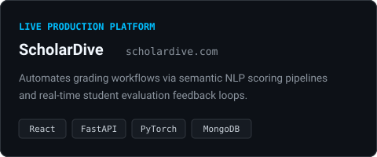
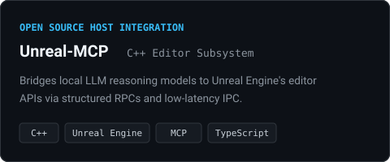
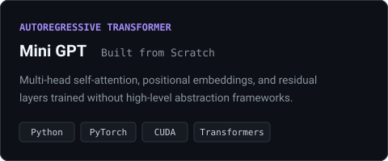
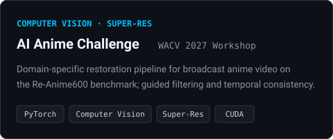
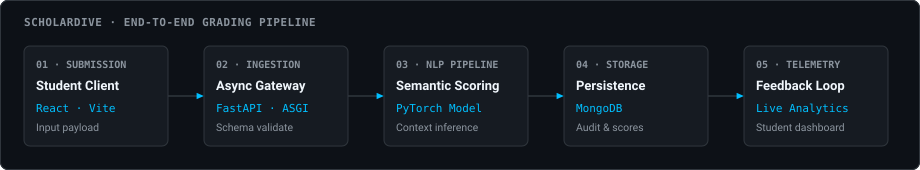
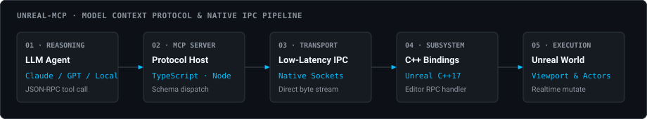
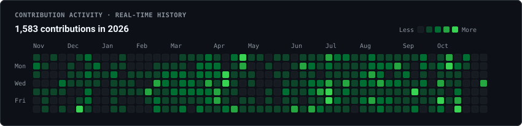

 

## About

Computer science undergraduate focused on **low-latency systems (C++)**, **applied AI pipelines** and **distributed backend platforms**. I co-build [ScholarDive](https://www.scholardive.com/) and author [Unreal-MCP](https://github.com/Deepesh70/Unreal-MCP), a bridge that lets LLM agents drive Unreal Engine. I care about clean system boundaries, low-overhead inter-process communication and architecture that scales.

| | |
|---|---|
| **Building** | ScholarDive, an adaptive assessment platform with NLP-based grading |
| **Shipped open source** | Unreal-MCP, Mini GPT, AI Anime Challenge |
| **Strongest at** | C++ and Python, backend services, ML from first principles |
| **Looking for** | SDE internships, systems programming, high-impact applied AI roles |

## Featured projects

<table>
  <tr>
    <td width="50%"></td>
    <td width="50%"></td>
  </tr>
  <tr>
    <td width="50%"></td>
    <td width="50%"></td>
  </tr>
</table>

<b>ScholarDive</b>: what I built and how it fits together

 

- **Semantic scoring.** Evaluation microservices on custom NLP pipelines that cut the manual, subjective part of grading.
- **Submission backend.** Asynchronous, low-latency services for ingesting and validating student submissions and reporting analytics.
- **Feedback loop.** Real-time telemetry so students see contextual feedback and performance tracking immediately.

  

<b>Unreal-MCP</b>: what I built and how it fits together

 

- **Native engine RPCs.** C++ bindings into Unreal Engine editor subsystems so an external reasoning model can control the viewport, actor transforms and scene assets.
- **Low-latency IPC.** Inter-process communication structured inside the native runtime for fast round-trip command execution.

  

<b>Mini GPT</b>: what I built

 

- **First principles.** Multi-head scaled dot-product attention, positional embeddings, layer normalization and residual layers, written without high-level abstraction frameworks.
- **Training.** Custom tokenization and GPU-accelerated batch training loops, with perplexity convergence benchmarks and KV-cache inference.

<b>AI Anime Challenge</b>: what I built

 

- **Domain restoration.** Engineered a video restoration and super-resolution pipeline targeting broadcast anime video on the Re-Anime600 benchmark (AINIME Challenge @ WACV 2027 Workshop).
- **Temporal consistency.** Implemented guided filtering and temporal consistency algorithms in PyTorch and CUDA to suppress compression artifacts and edge flickering.

## Stack

## How I like to build

| Clean system boundaries | Low-overhead IPC | Scalable by design |
|---|---|---|
| Small services with clear contracts, so scoring, ingestion and analytics can change independently. | Keep the hot path inside the process and the messages between processes small. | Cache in front of slow or rate-limited dependencies, and keep the write path asynchronous. |

## Activity

 

  

 

If something here is useful, you can [buy me a coffee](https://buymeacoffee.com/deepesh70).

